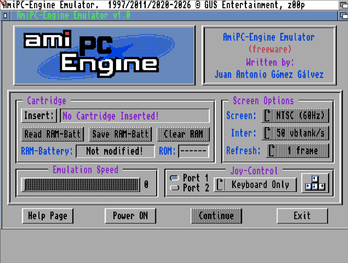
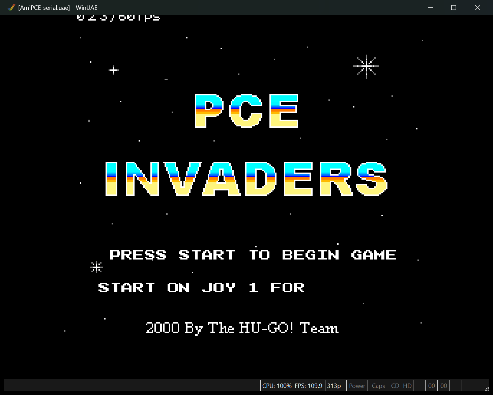
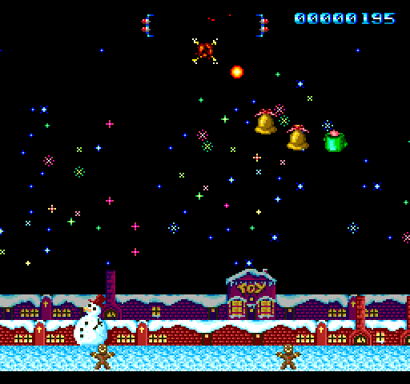
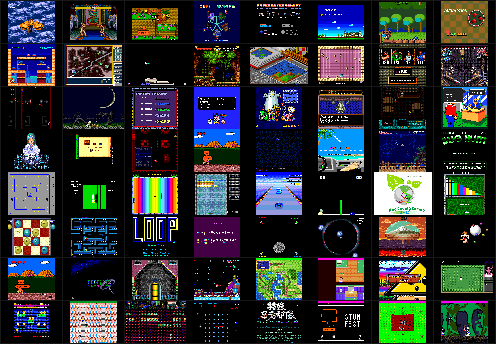

# AmiPCEngine

AmiPCEngine is a PC Engine / TurboGrafx-16 emulator for AGA Amigas, by
Juan Antonio Gomez Galvez and z00p, written in 68020+ assembly. It plays HuCard
games (`.pce` files) and drives the Amiga's custom chips directly, or a
Picasso96 (RTG) screen such as a PiStorm's HDMI output.

No games are included. Bring HuCard images you may legally have.

## History

Juan began AmiPC-Engine about 1997. The first "Version Alpha" was
"abandoned due the Amiga AGA limitations", in his words. Version 0.1
followed in 2011 and the preview 0.3 on Aminet on 30 June 2020
(`misc/emu/amipc-engine.lha`): 4 of the 6 sound channels, one sprite
palette, and a 68060 at 50 MHz as the minimum for real speed. Earlier
packages were `misc/emu/pcengine_01.lha` and `misc/emu/AmiPCEngine.lha`
(replaced by 0.3).
His later version 0.5 (June 1st, 2021) was never released. In 2026 Juan
sent his sources. This is a community update, released with his
permission.

It is built from them and finishes the project he started:
all 6 PSG channels with DDA samples, every sprite palette on RTG, and
full speed on an A1200 with a PiStorm. What changed is in
[CHANGES.md](CHANGES.md).

## Running it

The release archive holds the AmiPCEngine drawer: AGA (the AGA video
output, with the PC Engine's own colours), RTG (the same program on a
Picasso96 screen, ToolType `RTG`), `ReadMe.txt` and an empty `Homebrew`
drawer for your `.pce` files. It needs a fast machine: an A1200 with a
PiStorm, a fast 68060 or similar. The
manual is [docs/package/ReadMe.txt](docs/package/ReadMe.txt): requirements,
the menu, keys and pads, and the limits.

Tested by us on an A1200 with a PiStorm (RTG and AGA) and in WinUAE. Not
tested on a real 68060 card. Not all games work. Not
supported: CD-ROM games, SuperGrafx.

## Building

- Assembler: [vasm](http://sun.hasenbraten.de/vasm/) 2.0 or later, the
  68k Motorola-syntax version (`vasmm68k_mot`). Put it at
  `tools/vasmm68k_mot.exe` or change `build.sh`.
- `sh build.sh` assembles `src/Build.asm` (which includes `Main.asm`) into
  `build/AmiPCEngine`, the menu build, as a test build: it writes
  `src/buildinfo.i` (the date and commit in the window title; needs git).
  `sh build.sh release` makes the release build (the window title from the
  source, `-DNO_BUILDINFO=1`); `sh build.sh debug` the same with the debug
  rows, as `build/AmiPCEngine_Debug`. `sh build.sh colour` makes
  the program that ships (`-DAGC=1`: the AGA picture in the PC Engine's own
  colours; RTG with the word `RTG`).
- The vasm line, for reference:
  `vasmm68k_mot -devpac -nocase -m68020 -Fhunkexe -nosym -maxerrors=0 -o AmiPCEngine Build.asm`
  run inside `src/`.
- Debug and test code sits behind assembly switches (`-DName=1`), off by
  default. The switch block is at the top of `src/Main.asm`. `-DDbgRows=1`
  draws timing rows at the top of the screen
  (see `docs/package/Debug rows.txt`).
- Release package: `python tools/make_release.py --build --version 2.1`
  builds the release binary and stages the drawer; the archive is made with
  the Amiga's own `lha`.

## Layout

| Path | What |
|---|---|
| `src/` | the source: `Main.asm` (start-up, screen, input), `AGC.asm` (the AGA picture in the PC Engine's colours), `CPU.asm` (HuC6280), `PCE.asm` (frame and line loop, VDC interrupts), `IO.asm` (I/O page: VDC, VCE, PSG, timer, pad), `VDP_AGA.asm` (AGA renderer), `RTG.asm` (RTG renderer), `PSG.asm` (sound on Paula), `Menu.asm`, `GadToolsBox.asm` |
| `docs/package/` | the ReadMe that goes in the archive |
| `docs/shots/` | screenshots |
| `tools/` | `make_release.py`: builds the release binary and stages the drawer |
| `CHANGES.md` | changes from Juan's v0.5 |

## Credit

- **AmiPCEngine:** Juan Antonio Gomez Galvez (GUS Entertainment).
- **Versions 1.0 to 2.1:** z00p.
- **Web and menu graphics:** Multivac.
- **Thanks:** Zener and Sandman, and reassembler for his guidance and direction.
- Menu code made with Devpac III (HiSoft) and GadToolsBox (Jaba Development).

## Licence

AmiPCEngine is freeware by Juan Antonio Gomez Galvez. Versions 1.0 to 2.1, by
z00p, are community updates made and published with his permission. See [NOTICE.md](NOTICE.md).

## Trademarks

PC Engine is a trademark of NEC and Hudson Soft, TurboGrafx-16 of NEC.
This project is not affiliated with or endorsed by them.

## Reporting problems

Open an issue with the game, the icon you used (AGA or RTG), and your
machine: CPU or accelerator, or emulator, and the RTG board or screen
mode.